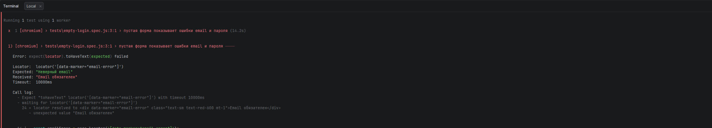
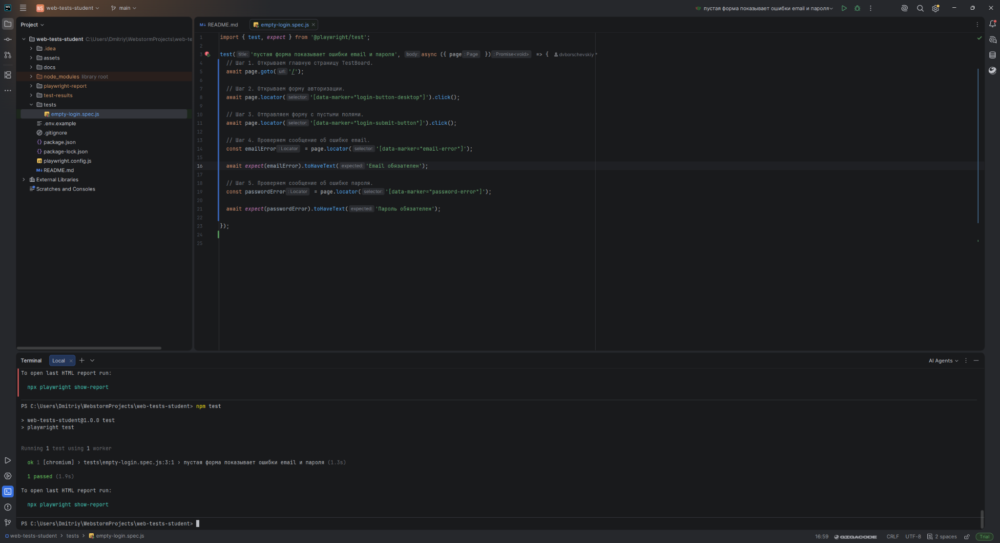

# Практическая работа №11 — Автоматизация UI

## Цель работы

Реализовать UI-автотест формы авторизации TestBoard с помощью JavaScript и Playwright.

**Файл теста:** `empty-login.spec.js`

## Проверяемый сценарий

1. Открыть главную страницу TestBoard.
2. Нажать кнопку «Вход и Регистрация».
3. Отправить форму входа с пустыми полями email и пароля.
4. Проверить сообщение «Email обязателен».
5. Проверить сообщение «Пароль обязателен».

Для поиска элементов использованы атрибуты `data-marker`, найденные через Chrome DevTools.

## Результаты тестирования

### 1. Демонстрация ошибки — FAIL

Для проверки механизма отладки я намеренно указал неправильный ожидаемый текст:

- **Expected:** `Неверный email`
- **Received:** `Email обязателен`

Playwright успешно нашёл элемент `[data-marker="email-error"]`, но проверка `toHaveText()` не прошла из-за несовпадения текста.

Это намеренная ошибка в ожидании теста, а не дефект приложения.



### 2. Исправление ошибки — PASS

После изменения ожидаемого текста на `Email обязателен` тест успешно выполнился.

**Результат:** `1 passed`.



## Запуск теста

Установка зависимостей:

```bash
npm ci
npx playwright install chromium
```

Запуск из корня проекта:

```bash
npm test
```

Запуск с видимым браузером:

```bash
npm test -- --headed
```

## Вывод

Реализован UI-автотест, проверяющий сообщения обязательности email и пароля при отправке пустой формы входа. Изучено использование локаторов Playwright, проверок `expect()` и анализ ошибок `Expected / Received`.